# Focuspocus

A small GUI library for Arduino projects with a display: buttons, labels,
checkboxes, radio buttons, sliders, progress bars and popups, with automatic
layout, touch input and button-driven focus navigation.

It is meant to be small and predictable:

- **No heap.** Widgets, screens and event handlers are plain global objects.
- **Draws only what changed.** A widget redraws itself when its value changes.
- **Any display** supported by Adafruit GFX (ILI9341, ST7735, SSD1306, ...).
- **Any input**: a touch screen, push buttons, a rotary encoder.
- **Testable on a PC.** The same code builds on Windows with a simulated
  display, and the library has unit tests.

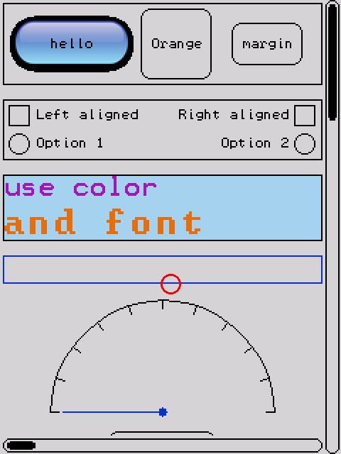

**Contents:** [Quick start](#quick-start) · [Examples](#examples) ·
[Concepts](#concepts) ([Screens](#screens), [Layout](#layout),
[Input and focus](#input-and-focus), [Events](#events),
[Loop, timers and drawing](#loop-timers-and-drawing)) ·
[Widgets](#widgets) ([Themes](#themes), [Custom widgets](#custom-widgets),
[Other displays](#other-displays), [Fonts](#fonts)) · [Testing on Windows](#testing-on-windows) ·
[Testing in Wokwi](#testing-in-wokwi)

## Quick start

```cpp
#include <Adafruit_ILI9341.h>
#include <Adafruit_FT6206.h>
#include <Focuspocus.h>

Adafruit_ILI9341 tft(10, 9);
Adafruit_FT6206 touch;

// A screen: a column with a label and a button.
BTextLabel label;
BButton button;
BView* columnItems[] = { &label, &button };
BStackPanel column(columnItems);
BRootView mainScreen(column);

// The GUI: display + theme + screens.
BAdafruitGraphics graphics(tft);
BTheme theme;
BRootView* screens[] = { &mainScreen };
BFocusManager fm(graphics, screens, theme);
BMouse mouse(fm);

void onClick(BButton*, bool) { label.setText("Clicked!"); }

void setup() {
  tft.begin();
  touch.begin(40);
  label.text = "Hello";
  button.text = "Click me";
  button.onClick += onClick;
  column.width = -1;                   // fill the screen
  column.height = -1;
  column.orientation = B::vertical;
  column.horizontalAlignment = B::center;
  column.verticalAlignment = B::center;
}

void loop() {
  // One read: touched() then getPoint() can see a finger lift in between and return 0,0.
  TS_Point p = touch.getPoint();
  if (p.z) {
    mouse.move(tft.width() - p.x, tft.height() - p.y, true);
  } else {
    mouse.button(false);
  }
  fm.loop(millis());
}
```

## Examples

| Example | Shows | Hardware |
|---|---|---|
| [HelloButton](examples/HelloButton/HelloButton.ino) | label, button, `setText` | ILI9341 + FT6206 touch |
| [Dialog](examples/Dialog/Dialog.ino) | a second screen, `BPopup`, `push`/`pop` | ILI9341 + FT6206 touch |
| [SensorGauge](examples/SensorGauge/SensorGauge.ino) | progress bar, live values, `BGauge`, a blinking custom widget (`tick`) | ILI9341, analog sensor |
| [OledMenu](examples/OledMenu/OledMenu.ino) | checkbox, radio buttons, 3 push buttons, `BBWTheme`, `onTimerTick` | SSD1306 128x64 OLED |
| [LayoutFocus](examples/LayoutFocus/LayoutFocus.ino) | stretch, min/max, margins, alignment; focus order through nested panels, per-screen focus | ILI9341 + FT6206 touch |
| [Demo](examples/Demo/Demo.ino) | everything: a scrollbar turning a gauge, a scrolled viewport, a list popup, a bitmap button | ILI9341 + FT6206 ([Wokwi](https://wokwi.com/projects/477626374678837249)) |

Every example has a Wokwi `diagram.json`, so it runs in the [Wokwi](https://wokwi.com)
simulator (VS Code extension or `wokwi-cli`) after an `arduino-cli` build;
see [Testing in Wokwi](#testing-in-wokwi).

**Board size.** The library adds about 12-16 KB of flash. The simple TFT
examples fit an Uno (HelloButton uses 93%), but a Mega, Nano Every, or any
32-bit board (SAMD, ESP32, RP2040) leaves room for your own code. OledMenu
needs more than an Uno: the SSD1306 driver alone needs 1 KB of RAM.

## Concepts

### Screens

A screen is a panel wrapped in a `BRootView`. The focus manager keeps a stack
of screens and shows the top one. `fm.push(screen)` shows another screen
(a dialog, a menu page), `fm.pop()` returns to the previous one. The stack size
is the size of the array given to `BFocusManager`; unused slots are `nullptr`:

```cpp
BRootView* screens[3] = { &mainScreen };   // room for 2 more
```

A screen made of a `BPopup` shades the screen below it instead of covering it.
Grouping each screen's widgets in a `namespace` keeps larger sketches tidy
(see Dialog and Demo).

### Layout

Each view has `width` and `height`, which tell the parent panel how to size it:

| value | meaning |
|---|---|
| `> 0` | fixed size in pixels |
| `0` | size to content (text, children) |
| `< 0` | share of the remaining space: `-1` and `-2` split it 1:2 |

`minWidth`, `maxWidth`, `minHeight`, `maxHeight` limit shared sizes.
After layout, the real size is in `actualWidth` / `actualHeight`.
A panel sized to content counts shared children at their content size, so a
column of `width = -1` buttons is as wide as its widest button and every
button gets that width.

- `BStackPanel` places children in a row (`B::horizontal`) or a column
  (`B::vertical`), with `spacing`, `horizontalAlignment` and
  `verticalAlignment` (`B::left/top`, `B::center`, `B::right/bottom`).
- `BPanel` places children at their `x`, `y`.
- `margin(n)` (all views) and `padding(n)` (panels) add space;
  `margin.left = n` sets one side (-128..127 px). `border = true` draws a panel border.

**Too little room.** Shared (`< 0`) sizes shrink to 0 first; fixed and
content sizes are kept and overflow the panel. Drawing is clipped to the
parent's client area: a view partly outside it shows only its inside part
(bitmaps are cut by whole rows, and skipped when cut on the left or right).

**Scrolling.** Put a tall `BStackPanel` inside a fixed-size `BPanel` with a
background, move it with `content.y = -offset;` and call `viewport.dirty();`.
Rows cut by the viewport's edge are drawn clipped; taps outside it are ignored.
The Demo scrolls its main page this way with a `BScrollbar`.

Children live in a fixed array. Empty (`nullptr`) slots can be filled later
with `panel.add(view)`; `remove(view)` frees a slot. `BStackPanel panel(8)`
instead allocates room for 8 children on the heap.

### Input and focus

The sketch reads the hardware and forwards it:

- **Touch / mouse**: `mouse.move(x, y, pressed)` and `mouse.button(pressed)`.
- **Keys**: `keyboard.sendKey(BKeyboard::kbEnter, pressed)` clicks the focused
  widget. Arrow keys move sliders.
- **Focus**: `fm.focusNext()`, `fm.focusPrev()`, `fm.focusFirst()`,
  `fm.focus(view)` (returns `false` for views that are not focusable). Set
  `screen.focused = &button` to choose what is focused when a screen is shown.
- **Push buttons**: `BButtonPin` debounces a pin and raises `onChange(pressed)`.
  Call `update(millis())` in `loop()` (see OledMenu).

### Events

Widgets report changes through events. A handler is a function, or an object
plus a method:

```cpp
void onClick(BButton* sender, bool) { ... }
button.onClick += onClick;
button.onClick -= onClick;
button.onClick += BButton::ClickEvent(&myObject, &MyClass::onClick);
```

Events are [Eventfun](https://github.com/glutio/Eventfun) `EventSource`s with
room for a fixed number of handlers: each widget event holds **one** (`+=`
returns `false` when it is taken); the focus manager's events hold two.

### Loop, timers and drawing

Call `fm.loop(millis())` from `loop()`. It runs timers about every 16 ms,
then layout, then draws the views that changed.

- `fm.onTimerTick` runs every timer tick, whatever screen is shown.
- `BView::tick(ms)` is called on each view of the visible screen, every
  timer tick, with the time passed to `fm.loop()`. Override it to animate a
  widget without code in `loop()`; views on hidden screens get no ticks, so
  they pause while covered. `BInterval` runs something every N ms:

  ```cpp
  class PulsingBar: public BProgressBar {   // like the Demo's
    BInterval step = BInterval(50);
  public:
    void tick(unsigned long ms) {
      if (step.elapsed(ms)) setValue(value >= maximum ? minimum : value + 1);
    }
  };
  ```
- `fm.onBeforeRender` / `fm.onAfterRender` run around each redraw. Buffered
  displays (SSD1306) send the frame in `onAfterRender`.

To change a widget, set its fields and call `dirty()` (redraw) or
`dirtyLayout()` (size may change). The setters do this for you:
`label.setText()`, `progress.setValue()`, `scrollbar.setValue()`.
Drawing outside `draw()` uses `fm.getGraphics(view)`; nothing is drawn if
the view is not on the visible screen.

## Widgets

| | | | |
|:-:|:-:|:-:|:-:|
| 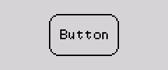 | 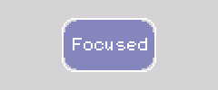 | 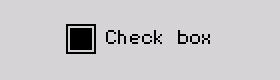 | 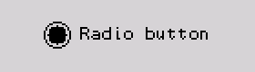 |
| `BButton` | focused | `BCheckBox` | `BRadioButton` |
| 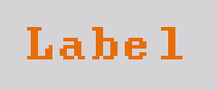 | 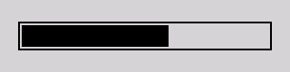 | 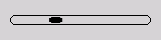 | 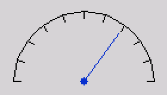 |
| `BTextLabel` | `BProgressBar` | `BScrollbar` | `BGauge` |

| Widget | Fields | Events / methods |
|---|---|---|
| `BTextLabel` | `text`, `fontSize`, `fontColor`, `horizontalAlignment`, `verticalAlignment` | `setText(text)` |
| `BButton` | `text`, `fontSize`, `fontColor`, `color`, `background` | `onClick(sender, bool)` |
| `BBitmapButton` | `bitmap` (RGB565), `mask` (1-bit), plus `BButton`'s | `onClick` |
| `BCheckBox` | `text`, `state`, `alignment`, `boxSize` | `onChange(sender, state)` |
| `BRadioButton` | as `BCheckBox`, plus `group` (radios with the same group exclude each other) | `onChange(sender, state)` |
| `BProgressBar` | `minimum`, `maximum`, `value`, `orientation` | `setValue(v)` (clamped) |
| `BScrollbar` | `minimum`, `maximum`, `value`, `step`, `orientation` | `setValue(v)`, `onChange(sender, value)` |
| `BGauge` | `minimum`, `maximum`, `value`, `needleColor` | `setValue(v)` (clamped, redraws only the needle) |
| `BStackPanel`, `BPanel` | see Layout | `add`, `insert`, `remove` |
| `BPopup` | a centered `BStackPanel` that shades the screen below | |

`color`, `background`, `fontSize` and `fontColor` default to the theme.

| | | |
|:-:|:-:|:-:|
| 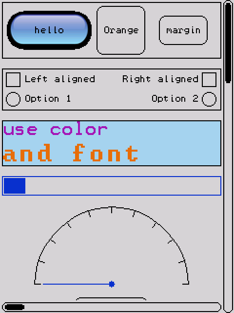 | 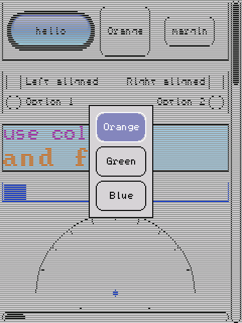 | 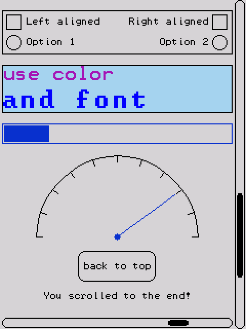 |
| Demo | a list in a `BPopup` | scrolled to the end |

### Themes

`BTheme` holds colors and sizes shared by all widgets (button size and radius,
checkbox size, scrollbar size, focus colors, ...). Three are included:
`BTheme` (dark, color TFT), `BWinTheme` (light gray) and `BBWTheme`
(monochrome, small sizes for 128x64 OLEDs). Change any field before `setup()`
ends, or derive your own.

### Custom widgets

Derive from `BView` (display only) or `BControl` (focusable), and override:

- `draw(BGraphics& g)`: draw in local coordinates, `g.width` x `g.height`.
- `measure(availableWidth, availableHeight)`: set `actualWidth` /
  `actualHeight` to the content size when `width` or `height` is 0 or
  shared (`< 0`).
- `handleEvent(BInputEvent& e)`: react to mouse/keyboard/focus events.
- `tick(ms)`: animate.

To make a widget that clicks like a button but draws differently, derive from
`BButton` and override `draw()`, `measure()` and `clicked()` (`BCheckBox` does
this). Define `FOCUSPOCUS_SHOW_BOUNDS` when building to outline every view and
its margin in red.
Declare events with `BEVENT(Name, SenderType, ArgumentType)`. See
`AlarmLabel` in SensorGauge and `PulsingBar` in Demo.

[BGauge.h](src/BGauge.h) is a complete example built only on the public API:
a dial that repaints only its needle on `setValue()` (via
`focusManager().getGraphics(*this)`), with no floats. Copy it as a template.

### Other displays

`BAdafruitGraphics` wraps any `Adafruit_GFX`. For another graphics library,
implement `BGraphicsApi` (rectangles, round rectangles, circles, lines, text,
bitmaps). Before each call the library passes the visible area to `setClip`,
and the driver must not draw outside it. `BAdafruitGraphics` draws shapes that
fit straight to the display, and the rest through a small `Adafruit_GFX` wrapper
that drops pixels outside the clip. It assumes the built-in 6x8 font.

### Fonts

Text uses the Adafruit built-in 6x8 font, scaled by `fontSize`. For an
[Adafruit GFX font](https://learn.adafruit.com/adafruit-gfx-graphics-library/using-fonts),
use `BAdafruitFontGraphics`; it draws and measures all text with that font
(`fontSize` still scales it):

```cpp
#include <Fonts/FreeSans9pt7b.h>
BAdafruitFontGraphics graphics(tft, &FreeSans9pt7b);
```

A font costs flash (FreeSans9pt7b is about 2 KB); with
`BAdafruitGraphics` none of this code is linked in.

## Testing on Windows

`extras/win32` contains a `BGraphicsApi` that draws into a window, and `test/`
holds unit tests ([doctest](https://github.com/doctest/doctest)) that
drive the GUI with simulated taps and keys and check what was drawn. CMake
expects Eventfun and Buratino checked out next to this repository (or pass
`-DEVENTFUN_DIR=...` and `-DBURATINO_DIR=...`).

```
cmake -S . -B build -A x64
cmake --build build --config Debug
build\Debug\focuspocus_tests.exe     # unit tests
build\Debug\focuspocus_demo.exe      # the Demo screens in a window
build\Debug\focuspocus_layoutfocus.exe  # the LayoutFocus screens
build\Debug\focuspocus_screenshots.exe  # docs/images/*.png (run from the repository root)
build\Debug\focuspocus_screenshots.exe gif && python extras\win32\demogif.py  # examples/Demo/demo.gif
```

## Testing in Wokwi

Each example has a `test.yaml` [scenario](https://docs.wokwi.com/wokwi-ci/automation-scenarios)
that taps the touch screen, presses buttons or turns the potentiometer, and
compares the display with the reference images in `screenshots/`.
`extras/wokwi/run.ps1` builds the examples for a Mega and runs them
(needs `arduino-cli`, `wokwi-cli`, a `WOKWI_CLI_TOKEN`, and the Eventfun and
Buratino checkouts as above):

```
.\extras\wokwi\run.ps1                # all examples
.\extras\wokwi\run.ps1 Dialog          # one example
.\extras\wokwi\run.ps1 -Update         # re-record the reference images
```

`extras/wokwi/bundle.ps1` makes a flat copy of each example in
`build/wokwi/<Name>` (sketch, `diagram.json`, `libraries.txt` and the
Focuspocus, Buratino and Eventfun sources) that can be uploaded to a
[wokwi.com](https://wokwi.com) project as is.

## License

MIT, see [LICENSE](LICENSE).
